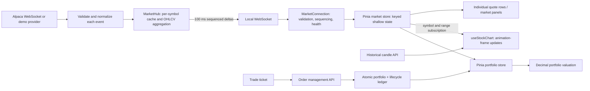
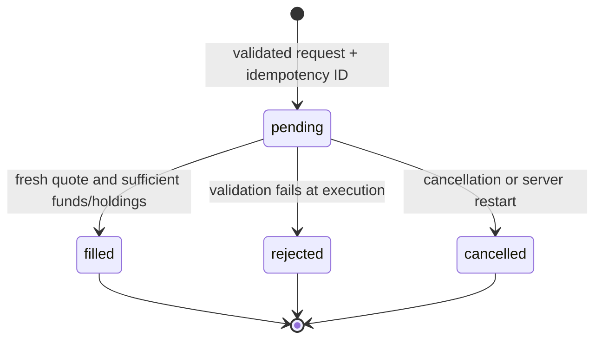

# Pulse technical architecture

Pulse is a single-user, local stock terminal. Market-data processing, chart rendering, order execution and portfolio valuation have separate modules and explicit contracts. All trades are simulated; live-provider credentials stay on the server.

## Runtime data flow

### Market-data responsibilities

- `server/providers/event-processor.ts` validates trade and quote fields, rejects crossed bid/ask values and future/delayed timestamps, tracks separate trade/quote clocks and deduplicates trades using provider IDs (or a timestamp/price/size fingerprint).
- `server/providers/alpaca.ts` owns authentication, subscriptions, upstream ping/pong, reconnection and historical REST access. Subscriptions are sent after every successful authentication. Missing keys select explicitly labelled demo mode; authentication rejection is shown as disconnected and requires configuration correction/restart.
- `server/market-hub.ts` receives **every accepted normalized update before throttling**. It keeps the newest quote per symbol and accumulates OHLCV for all five chart intervals. A flush sends only changed quotes/trails and cumulative candle buckets. Price extremes and bucket boundaries survive the 100 ms visual cadence.
- `shared/protocol.ts` defines the wire schema. Every server instance has a session ID; market deltas have a monotonic sequence. Initial subscription and resynchronization return complete snapshots. Heartbeats report the last market sequence so a dropped final delta can also be detected.
- `src/modules/market/connection.ts` is independent of Vue. It validates frames, drops duplicates/old frames, pauses synchronization on a sequence gap, requests a snapshot, and reconnects if synchronization does not recover. Portfolio messages are validated separately.
- `src/modules/market/store.ts` owns shallow reactive maps indexed by symbol. An update replaces only changed symbol entries. Static assets retain their identity, status fields update individually, and chart consumers subscribe by `symbol:range`.

### High-frequency updates and rendering

The server flushes market deltas on a 100 ms timer, while normalizing and aggregating all accepted upstream events. Initial and requested resynchronization snapshots are sent separately. The frontend uses stable per-symbol state rather than replacing the entire quote map. `WatchlistRow` subscribes to its own symbol; default watchlist ordering does not depend on price. Explicit price/change sorting and market-mover rankings necessarily recalculate when their ranking inputs change.

Market cards, account summaries, update timestamps and the status-bar clock have dedicated components. The shell still reads account values when its portfolio page or account popover is visible, and the live-mode session label depends on the clock. Portfolio valuation accesses only held symbols. A price change in an unrelated symbol therefore does not invalidate the valuation.

Charts receive cumulative OHLCV buckets through a subscription, independently of quote-list rendering. The renderer queues bucket updates by timestamp and applies them on `requestAnimationFrame`; it does not repeatedly call `setData` for ticks. Historical data is shallow, live storage is bounded to 1,000 chart bars, and absolute live-volume baselines prevent repeated messages from double-counting volume. A full resync reloads chart history to repair gaps. Historical responses are cancellable, validated, sorted and deduplicated.

Browser profiling is opt-in with `VITE_PROFILE_RENDER=1` in development. Normal development and production leave Vue profiling disabled.

### Connection health and stale data

There are two independently monitored links:

1. **Provider → server:** connection and authentication deadlines, ping/pong every 20 seconds, termination after a missed pong, and exponential retry capped at 30 seconds. Provider authentication failures stop automatic retries; no fabricated live prices replace unavailable exchange prices.
2. **Server → browser:** exponential retry from 1 second to 30 seconds, a 10-second connection/snapshot deadline, and a 25-second timeout for valid heartbeat/market messages. Retry attempts reset only after a stable connection, avoiding rapid reconnect loops. Online/offline events trigger recovery. Every connection restores the configured-universe subscription and a full snapshot.

Transport health and quote freshness are different. A one-second freshness check updates a per-symbol flag only when it changes. Prices older than 60 seconds remain visible as **stale**, the chart and watchlist label them, portfolio values are marked estimated, and fresh bid/ask data is required to execute an order. Markets can be closed while the connection itself remains healthy.

Slow WebSocket consumers are closed rather than silently dropping deltas; they reconnect with a snapshot. Duplicate and out-of-order application frames never overwrite the cache. Schema-invalid market frames trigger resynchronization when already synchronized, and timestamps more than five seconds in the future are rejected. Malformed JSON and messages without a type are counted and ignored; sustained silence still triggers the health timeout.

### Charting responsibilities

`src/modules/chart/useStockChart.ts` owns the Lightweight Charts instance, historical loading, timeframe changes, currency formatting, selected-series subscription, animation-frame queue and resize observer. `aggregate.ts` implements the candle merge. `MarketChart.vue` renders controls and labels. On unmount, requests are aborted, chart subscriptions are removed, pending animation frames are cancelled, the resize observer is disconnected and the chart is destroyed.

Live display candles aggregate accepted normalized prices, including quote updates, in UTC buckets. They are a visual approximation, not official exchange-finalized bars. History and live bars can overlap; the historical response provides the live-volume baseline at retrieval time. The five ranges use shared interval definitions. Changing display currency affects formatting only, not the stored USD candle values.

### Order-management responsibilities

`server/order-manager.ts` is the single writer of simulated order state. `src/modules/orders/store.ts` submits instructions, reconciles the authoritative status and exposes cancellation. `validation.ts` contains reusable UI validation/sizing; the server independently revalidates everything.

A 700 ms simulated execution delay makes pending orders observable and cancellable. It is deliberately simulation latency, not a claim about exchange behavior. Funds are **not reserved**: each fill rechecks the latest committed portfolio, so competing pending orders may be rejected rather than overspend. Settlement is synchronous within the single Node process, preventing fill/cancel interleaving.

- `POST /api/orders` accepts `{ id, input: { symbol, side, quantity } }` and returns the pending request.
- `GET /api/orders/:id` returns lifecycle state and the authoritative portfolio.
- `POST /api/orders/:id/cancel` cancels a pending request and is harmless for a terminal request.

The same ID and instructions return the existing request rather than execute twice; a reused ID with different instructions is rejected. The ledger keeps the latest 200 requests, so idempotency is bounded by retained history. Pending requests left after a crash are cancelled on restart, not silently replayed. Graceful shutdown cancels active timers. Fill state, cash, holdings and the fill record are committed in a single atomic JSON replacement before publication. If persistence fails, no fill is acknowledged; a visible pending request can be cancelled or recovered on restart.

Invalid request structure receives HTTP 400. A structurally valid order that cannot execute becomes a persisted **rejected** request, with its reason displayed in Activity. Cancellation and rejection do not change cash or positions. The UI does not automatically resubmit after an ambiguous timeout; it tells the user to check Activity.

### Portfolio responsibilities

`server/trading.ts` contains pure, decimal-based fill calculations. `server/portfolio.ts` validates and atomically persists the account. Existing accounts without a lifecycle ledger load with an empty ledger; previous fills and balances are retained.

`src/modules/portfolio/store.ts` owns the account snapshot; `valuation.ts` computes market value, equity, unrealized P/L and total performance with decimal arithmetic. Missing prices use average cost and are explicitly marked estimated. The `terminal` store is a UI compatibility facade exposing market/account refs plus navigation, selection and watchlist preferences; it no longer owns financial calculations or socket lifecycle.

USD remains the accounting currency. Display FX conversion does not alter order quantities, buying power validation, percentage returns or execution prices.

## Build verification

`npm run build` includes strict frontend and backend TypeScript checks. Automated test suites are not included in this repository snapshot.

## Deliberate limits

- The provider trade/quote stream does not expose an end-to-end replay sequence in this adapter. Local frame gaps are recoverable by snapshot/history; undelivered upstream trades cannot be reconstructed exactly. Timestamp checks and deduplication are not an exchange audit log.
- The deduplication cache is bounded to 20,000 event identities, and timestamps use JavaScript millisecond precision. Distinct trade IDs at equal timestamps remain distinct; without IDs identical fingerprints can be collapsed. There is no unbounded tick retention.
- Price snapshots may skip intermediate displayed numbers, but accepted candle extremes/volume are aggregated before batching. Reconnect backfill depends on provider historical-data availability.
- All configured symbols (maximum 50) are subscribed together because movers and held positions need data outside the watchlist. Chart consumers subscribe locally only to the selected symbol/range.
- JSON persistence is appropriate for a local single-user demo. Synchronous disk writes are outside the quote pipeline but may briefly block Node during orders. Public/multi-user deployment needs authentication, durable transactional storage and independent account isolation.
- Live provider credentials are not supplied. Actual entitlements, live exchange latency and upstream recovery remain account-dependent.
